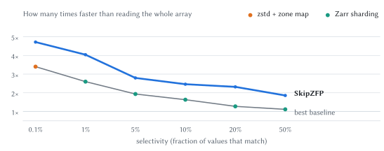
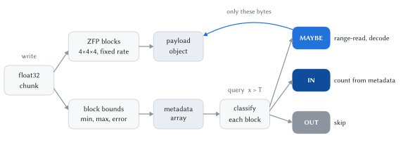

# SkipZFP

[](https://github.com/Juhani1104/SkipZFP/actions/workflows/ci.yml)
[](https://codecov.io/gh/Juhani1104/SkipZFP)
[](https://zarr-specs.readthedocs.io/en/latest/v3/core/index.html)
[](https://github.com/LLNL/zfp)
[](LICENSE)
[](https://github.com/astral-sh/ruff)

**Make ZFP-compressed arrays queryable.**

SkipZFP is a Zarr v3 codec for float32 scientific arrays. It compresses data with
[ZFP](https://github.com/LLNL/zfp) in fixed-rate mode and keeps a few bytes of bounds
for every 4×4×4 block, so a query such as *count(x > T)* can tell which blocks cannot
match, skip them without reading them, and decode only those that might.

<p align="center">
  <picture>
    <source media="(prefers-color-scheme: dark)" srcset=".github/speedup-dark.svg">
    
  </picture>
</p>

<sub>Threshold queries (count of x > T) on ten years of hourly ERA5 temperature, 11.5 GB, read
from Google Cloud Storage.</sub>

- **Reads only what can match.** Fixed-rate blocks sit at computable offsets, so the
  planner turns the surviving blocks straight into byte-range requests.
- **Faster than every baseline, up to 50% selectivity.** On ten years of ERA5 2 m
  temperature in Google Cloud Storage, threshold queries are 1.3–1.6x faster than the
  fastest baseline from 1% to 50% selectivity, and 1.7–5.4x faster than a zstd full
  scan.
- **Small and standard.** Block bounds add 3.16% to an 8 bpv payload, and the arrays are
  ordinary Zarr v3 arrays with no side index.

## Installation

Requires [libzfp](https://github.com/LLNL/zfp) 1.0 and a C compiler.

```bash
git clone https://github.com/Juhani1104/SkipZFP.git
cd SkipZFP
pip install -e .
```

If libzfp is installed elsewhere, point to it:

```bash
ZFP_DIR=/path/to/zfp pip install -e .
```

## Quick start

```python
import numpy as np
import zarr
from skipzfp import SkipZFPCodec, query_gt, query_lt, query_range, write_meta

# a smooth synthetic field: 256 hours on a 128 x 256 grid
t, y, x = np.meshgrid(np.arange(256), np.arange(128), np.arange(256), indexing="ij")
data = 280 + 10 * np.sin(x / 20) + 8 * np.cos(y / 15) + 3 * np.sin(t / 30)
data = data.astype("float32")

codec = SkipZFPCodec(rate=8, sub_chunk=(64, 16, 32), block_order=(1, 2, 0))
z = zarr.open_group("demo.zarr", mode="w").create_array(
    "t2m",
    shape=data.shape,
    chunks=(64, 128, 256),
    dtype="float32",
    serializer=codec,
    compressors=None,
)
z[:] = data

# per-block bounds, stored next to the array
write_meta(z, data)

# count(x > 295), reading only the blocks that can match
r = query_gt(z, 295.0)
print(r.count, r.bytes_read, r.maybe_blocks, r.total_blocks)
# 630563 588800 5056 131072

# count(290 < x <= 295); query_lt counts x < T the same way query_gt counts x > T
r = query_range(z, 290.0, 295.0)
print(r.count, r.maybe_blocks)
# 1022169 13959
```

`query_gt`, `query_lt` and `query_range` take an opened Zarr array on any store (the
experiments read from Google Cloud Storage) or a path, and the result also reports
bytes, requests and time per stage. `query_gt` and `query_lt` take `inclusive=True` for
`>=` and `<=`; `query_range` counts `lo < x <= hi` by default, and `lo_inclusive` and
`hi_inclusive` switch either end. Tuning knobs such as threads, read concurrency and
the merging of nearby reads go in a `QueryOptions` passed as `options=`; the defaults
suit most queries.

## How it works

<p align="center">
  <picture>
    <source media="(prefers-color-scheme: dark)" srcset=".github/how-it-works-dark.svg">
     T reads only the metadata, classifies each block
              as MAYBE (range-read and decode), IN (count from metadata) or OUT (skip)">
  </picture>
</p>

1. **Fixed-rate blocks.** Every 4×4×4 block compresses to exactly `rate × 64 / 8`
   bytes, so block *k* starts at a known offset and can be fetched with a range request.
2. **Block bounds.** For each block SkipZFP keeps its minimum and maximum, quantized to
   one byte each within the sub-chunk's range, plus the sub-chunk's largest
   reconstruction error, so the bounds hold for both the original and the decoded
   values.
3. **Three-valued planning.** A block is OUT (skip), IN (every value matches; count it
   from metadata) or MAYBE (read and decode). Nearby MAYBE blocks are merged into one
   request, and decoding runs in C while later requests are still downloading.
4. **Layout knobs.** `sub_chunk` packs several small units into one object for fewer
   requests; `block_order=(1, 2, 0)` stores each block column along time contiguously,
   which makes a point time series one range read; `layers` stores bit-plane prefixes so
   a query can read only a lower-rate prefix.

### What each result means

ZFP is lossy, so every answer is about either the **decoded** values (what reading the
array returns) or the **original** values (what was written), and is either exact or a
guaranteed interval. The table says which, and whether it is a library call that reads
from a store or an offline analysis in `experiments/` that needs the original data.

| Result | Values | Exact or bounded | Where | Reads |
|---|---|---|---|---|
| `query_gt` / `query_lt` / `query_range` | decoded | exact COUNT | library | zone map + MAYBE blocks |
| `aggregate_gt` / `_lt` / `_range` | decoded | exact COUNT, SUM, AVG | library | zone map + IN and MAYBE blocks |
| same call, `original_*` fields | original | guaranteed COUNT, SUM, AVG intervals | library | as above |
| COUNT interval from the zone map alone | original | guaranteed interval | offline (`exp4`) | zone map only |
| Regional AVG / MIN / MAX bounds | original | guaranteed intervals | offline (`exp3`) | original data needed |
| `block_error_bits=4` | both | tighter IN/OUT and intervals | library option | +0.5 byte per block |
| `check_meta` | stored bytes | which chunks changed after `write_meta` | library | every chunk |

Each original value lies within its unit's (or, with `block_error_bits=4`, its block's)
measured error of its decoded value; every interval follows from that alone. The zone
map describes the payload as `write_meta` saw it: rewrite a chunk and run `write_meta`
again. A query refuses a zone map built for another codec, shape or chunk layout, and
`check_meta` finds chunks rewritten since.

## Results

From the experiments in [`experiments/`](experiments). Query times come from an
n2-standard-16 VM (us-central1-b) reading from Google Cloud Storage; accuracy and
overhead are computed offline.

| Experiment | Headline |
|---|---|
| Threshold query | 1.3–1.6x faster than the best baseline (t2m, 1–50%) |
| Point query | 140 KB per query; chunked and sharded Zarr read 0.8–19 MB |
| Aggregates | error bounds never violated; sampling CIs miss up to 14% |
| Filtered aggregates | guaranteed COUNT interval from metadata alone |
| Overhead | 3.16% at 8 bpv |

### Also on AWS

The same data and scripts were rerun on an m5n.4xlarge VM (us-east-1), reading from
Amazon S3 and from S3 Express One Zone, a lower-latency S3 storage class that keeps the
data in a single availability zone; we put it in the same zone as the VM. Threshold
query speedup over the best baseline on temperature (t2m):

| Selectivity | 0.1% | 1% | 10% | 50% |
|---|---|---|---|---|
| S3, original query | 1.6x | 1.3x | 1.1x | 1.2x |
| S3, optimized query | **2.4x** | **1.8x** | **1.4x** | **1.6x** |
| S3 Express, original query | 1.3x | 1.2x | 1.1x | 1.2x |
| S3 Express, optimized query | **2.1x** | **1.6x** | **1.5x** | **1.6x** |

The original query is the one measured on Google Cloud above. The optimized query reads
the zone map objects by key, plans and reads each one as soon as it arrives, and decodes
each read in place instead of copying it; together these cut query time on S3 by
16–35%. On wind speed (ws) it is 1.4–2.3x faster than the best baseline on both stores.

Unlike the Google Cloud run, the baselines on AWS also read without copying each
response, so these numbers are not directly comparable with the table above. Every
version runs interleaved with the others, so they all see the same network. Aggregates,
filtered aggregates and overhead give identical results on both clouds. Results are in
[`experiments/results_aws/`](experiments/results_aws).

## Reproducing the paper

| Level | Command | Needs |
|---|---|---|
| Redraw figures and tables | `python experiments/figures.py experiments/results` and `python experiments/summarize.py experiments/results` | this repo |
| Run the tests | `pytest` | this repo |
| Rerun everything | `BUCKET=gs://… bash experiments/run_cloud.sh` (or `s3://…`) | a GCP or AWS VM and bucket |

On a Debian 12 VM you create (any Linux with Python 3.11 or newer), `run_cloud.sh`
installs the dependencies, builds
libzfp, downloads ERA5 from the public
[ARCO-ERA5](https://github.com/google-research/arco-era5) store, writes every format to
your bucket, and runs each experiment. Every step can be rerun and resumes where it
stopped. Next to every results file, `<file>.runs.json` records each run's code version,
machine, package versions and data, and every row carries its `run_id`;
`summarize.py` turns the raw results into the tables. The published results used an n2-standard-16 VM in us-central1-b.

<details>
<summary>Paper figure / table → script → result file</summary>

| Paper | Script | Result |
|---|---|---|
| Point query | `exp1_point_query.py` | `results/exp1_point_query.jsonl` |
| Threshold query | `exp2_threshold_query.py` | `results/exp2_threshold_query.jsonl` |
| Aggregates | `exp3_aggregate.py` | `results/exp3_aggregate.json` |
| Filtered aggregates | `exp4_filtered_aggregate.py` | `results/exp4_filtered_aggregate.json` |
| Metadata overhead | `exp5_overhead.py` | `results/exp5_overhead.json` |
| Object-size sensitivity | `sensitivity_object_size.py` | `results/sensitivity_object_size.jsonl` |
| Ablation, one factor at a time | `ablation.py` | `results/ablation.jsonl` |
| Memory under a cgroup limit | `memory_limit.py` | `results/memory_limit.jsonl` |
| Build cost of the zone map | `build_cost.py` | `results/build_cost.jsonl` |
| All tables from the raw results | `summarize.py` | `results/summary.md` |
| Figures from the raw results | `figures.py` | `results/figures/` |
| README figure | `readme_figure.py` | `.github/speedup-*.svg` |
| README diagram | `readme_diagram.py` | `.github/how-it-works-*.svg` |

</details>

## Repository layout

```
skipzfp/        codec, query planner, and the C core (csrc/)
tests/          pytest suite, including direct tests of the C API
experiments/    data download, experiments, results, cloud runner
```

## Limitations

- float32, 3D arrays only; the array shape must be a whole number of chunks.
- NaN and infinite values are rejected (ZFP cannot encode them).
- Queries count values in a range (`query_gt`, `query_lt`, `query_range`) or
  return their COUNT, SUM and AVG (`aggregate_gt`, `aggregate_lt`,
  `aggregate_range`), exact for the decoded values with bounds for the original
  ones; aggregates read the blocks inside the range too.
- `max_inflight_bytes` bounds the payload held between reading and decoding, not
  the zone map or the planner's arrays, which grow with the array.

## Citation

A paper describing SkipZFP is in preparation.

## License

BSD 3-Clause. See [LICENSE](LICENSE).
